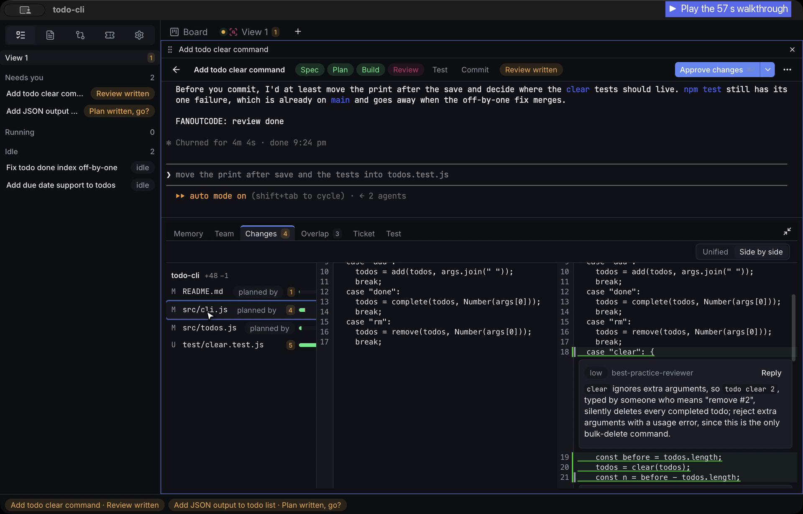

# Fanout Code

A macOS app for running several Claude Code or Codex agents at once. Each task is a card on a Kanban board, with its own terminal, git worktree and notes, and moves through **Spec → Plan → Build → Review → Test → Commit**. You approve each step.

[](docs/media/fanout-code-demo.mp4)

## How a task runs

| Stage      | The agent                                                                                      | You                                                                                                     |
| ---------- | ---------------------------------------------------------------------------------------------- | ------------------------------------------------------------------------------------------------------- |
| **Spec**   | —                                                                                              | Describe the task; the spec starts from your description. Edit it, then approve.                        |
| **Plan**   | Writes `plan.md`: numbered steps, the files each one changes, how each is proven.              | Read the checklist, start the build.                                                                    |
| **Build**  | Works through the plan in the task's own worktree (`.worktrees/<task>` on branch `fo/<task>`). | Watch the terminal, or answer when the card says _Your turn_.                                           |
| **Review** | Runs reviewer subagents and writes findings to `review.md`.                                    | Read the diff with findings inline, edit it in place, approve. Blockers are flagged before you approve. |
| **Test**   | Runs the project's test command; on failure, _Fix failing tests_ hands the output back.        | —                                                                                                       |
| **Commit** | Drafts a commit message per repo.                                                              | Commit yourself (default), or let the app commit.                                                       |

The card shows what each task needs: _Plan written, go?_, _Your turn_, _Trust this folder?_, _Tests failed_. **Needs you** counts them across the board.

## Features

- **Real terminals.** Each task runs your own `claude` or `codex` CLI in a PTY. Type into it at any time.
- **Parallel by default.** Each task gets its own git worktree, so tasks running at once don't touch each other's files. If two tasks change the same file, the app asks before the second edit.
- **Plain-file memory.** Each task keeps `intent.md`, `spec.md`, `plan.md`, `review.md` and `commits.md`, readable without the app.
- **Diff review.** Unified or side-by-side diff, with the review's findings inline and the files editable.
- **Team view.** A canvas of the agent's subagents and the plan steps they're on.
- **Workspaces.** Link several projects in one window, so agents can read across repos.
- **Keyboard first.** ⌘T new task, ⌘⏎ next step, ⌘K command palette.
- **Local only.** SQLite and files under `~/Library/Application Support`. No account; agents use your CLI login.

## Requirements

- macOS
- [Claude Code](https://docs.anthropic.com/en/docs/claude-code) (`claude`) or the Codex CLI, signed in
- Node 22 and a stable Rust toolchain, to build

## Build and install

```sh
git clone https://github.com/johnnycuongn/fanoutcode && cd fanoutcode
npm ci
npm run tauri build -- --bundles app
cp -R "target/release/bundle/macos/Fanout Code.app" /Applications/
```

On first launch the app checks which agent CLIs are installed. Then open a project folder and press **⌘T** for a new task.

## Develop

```sh
npm run tauri dev        # the app with hot reload
npx vitest run           # webview tests
cargo test --workspace   # Rust tests
npm run lint             # ESLint + Prettier
```

Read [`CLAUDE.md`](CLAUDE.md) for the repo rules and [`ARCHITECTURE.md`](ARCHITECTURE.md) for the layout. The Rust core (`crates/fanoutcode-core`) has no Tauri dependency. `src-tauri` is a thin shell, and `src/` is the React webview.
